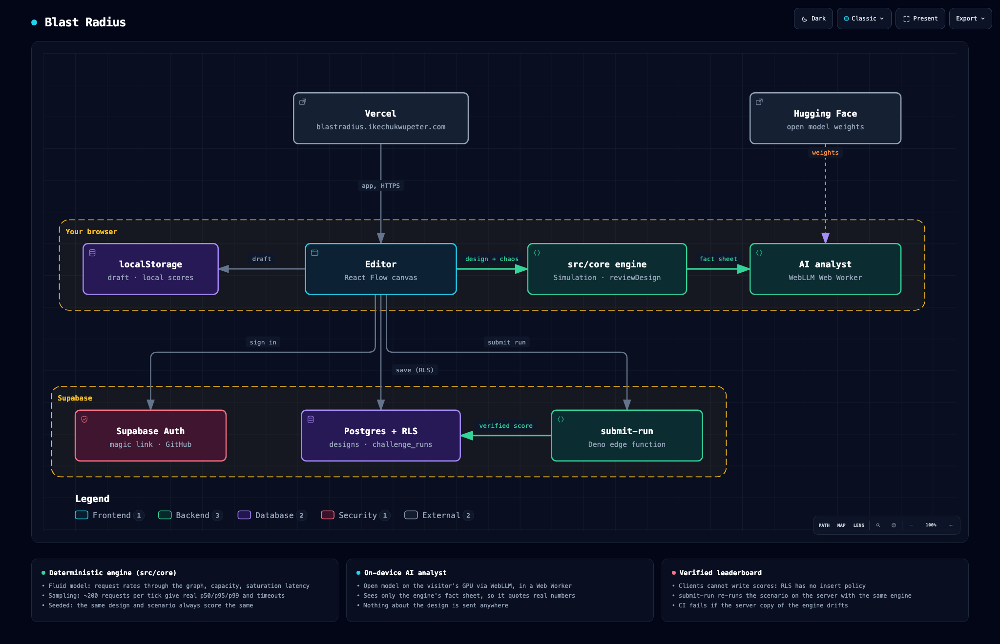

# Blast Radius — case study

> An architecture diagram that runs: design a system, simulate real traffic, break it, prove it survives, and ask an AI on your own GPU why it didn't.

## 1. The problem

Every system design conversation ends at a whiteboard diagram, and diagrams don't fail. Nobody can see that the single Postgres box takes the whole site down when it dies, that the cache in front of it turns a Redis outage into a database stampede, or that "add retries" turns a slowdown into an outage. Engineers learn these lessons in production incidents. I wanted a place to learn them in thirty seconds: draw the system, press Play, break it, and watch the blast radius spread.

## 2. Constraints, chosen deliberately

- **The picture must tell the truth.** Every particle, colour and number comes from a simulation, not an animation.
- **Same design, same result.** Scores must be reproducible, or a leaderboard means nothing.
- **Grades must be explainable.** A design review you can't trace to a rule is an opinion.
- **No AI bill and no AI privacy policy.** If there's an assistant, it runs on the visitor's machine and can only talk about facts the engine produced.
- **Useful signed out.** Design, simulate and take challenges with no account; sign in only to save, share and compete.

## 3. Architecture

**The engine (`src/core/`)** is pure TypeScript with no DOM. Each 100 ms tick, request rates flow through the graph, nodes saturate and drop, and about 200 sampled requests measure percentiles. It also holds the rule-based reviewer, the five scenarios and the cost model.

**The editor** is React with React Flow. A zustand store owns the design, with undo; a second store drives the engine on `requestAnimationFrame` and publishes ticks at 10 Hz to the node cards, the particle edges, the telemetry charts and the incident log.

**The AI analyst** runs a small open model through WebLLM on WebGPU, inside a Web Worker. It reads a fact sheet the engine writes, never the raw design alone.

**Supabase** provides auth, Postgres with row-level security, and one edge function, `submit-run`. That function re-runs scenarios with a Deno copy of the same engine, so the server's score is the score the player saw.

**Vercel** serves the static build with a strict Content-Security-Policy that names every host the app may talk to.

### Honest trade-offs

| Decision | What I gained | What it cost me |
|---|---|---|
| Seeded, time-stepped simulation | Reproducible scores, exact tests, a verifiable leaderboard | It's a model: capacities and prices are illustrative |
| Fluid model + sampled requests | Real p99 at 10 Hz in a tab; a 120 s scenario in ~0.3 s headless | Percentile noise of a few percent (identical every run) |
| One engine in browser and Deno | No second implementation to drift | A copy step, guarded by a CI test |
| Rule-based reviewer | Same grade every time; every finding testable | Only finds what a rule was written for |
| On-device AI analyst | Free, private, no key, works offline after first load | ~1 GB download, needs WebGPU, weaker than a hosted model |
| Supabase + RLS, no API server | No hand-written auth checks to forget | Policies must be tested against a live project |
| SVG particles on React Flow edges | Pan, zoom and routing for free | Particles show rate and latency qualitatively, not per request |

### Tech stack choices — what I picked and why

| Layer | Pick | Reason |
|---|---|---|
| Engine | TypeScript, no dependencies | Runs unchanged in the browser, Vitest and Deno |
| UI | React 18, Vite, Tailwind | Fast iteration; the canvas library is React-native |
| Canvas | React Flow (`@xyflow/react`) | Mature node/edge editing; custom nodes and edges |
| State | zustand | Small stores outside React; the sim loop publishes without re-rendering the tree |
| Charts | Recharts | Line charts with reference lines and shaded bands, little code |
| AI | WebLLM + Qwen 2.5 1.5B (default) | OpenAI-style API over WebGPU; permissively licensed small models |
| Backend | Supabase (Auth, Postgres, Edge Functions) | RLS instead of an API server; Deno functions can import the engine |
| Tests | Vitest, puppeteer-core | Unit tests on pure code; a real browser for the parts that only fail in one |
| Diagram | Archify | Interactive, validated architecture diagram from a JSON source |
| Hosting | Vercel, custom subdomain | Static build, security headers, preview deploys |

## 4. Ten decisions worth defending

Each one has its own record in [decisions/](decisions/README.md).

1. **Simulate, don't animate** ([001](decisions/001-simulation-over-animation.md)). An animation can't show a cascade it wasn't scripted to show.
2. **Rates plus samples** ([002](decisions/002-fluid-model-plus-sampling.md)). Rates give load cheaply; a small sample gives the tail latency that averages hide.
3. **One engine, two runtimes** ([003](decisions/003-one-engine-two-runtimes.md)). The browser and the server must agree to the last digit.
4. **Re-run scores on the server** ([004](decisions/004-server-verified-scores.md)). Anything the browser computes, the player can change.
5. **Rules over an LLM for grading** ([005](decisions/005-rules-over-llm-reviewer.md)). A grade must be the same tomorrow.
6. **AI on the visitor's GPU, fed facts** ([006](decisions/006-on-device-ai.md)). Free and private, and grounded so a small model explains rather than invents.
7. **Authorization in the database** ([007](decisions/007-supabase-rls.md)). Policies next to the data, then attacked from a real session.
8. **SVG particles, bucketed** ([008](decisions/008-svg-particles.md)). Smooth motion at a 10 Hz data rate without a second renderer.
9. **Never refuse a line** ([009](decisions/009-drawing-only-links.md)). Links the simulator can't run become drawing-only, so it draws like a diagram tool and still simulates correctly.
10. **Videos rendered in the browser** ([010](decisions/010-video-export-in-the-browser.md)). A canvas renderer plus WebCodecs makes a postable MP4 faster than real time, with no server and no upload. The preview and the encoder draw the same frames.

## 5. Measurements, not assumptions

From the test suite ([tests/](../tests/)) and the live project:

| | Result |
|---|---|
| Unit tests | 71, in about 4 s; 91% line coverage of the engine, link geometry, AI fact sheet and design store |
| Browser smoke test | 22 checks on the production build, under the production CSP, including drawing |
| Determinism | Identical scores across runs, and between Node and Deno, for all 3 templates × 5 scenarios |
| Winnability | A reference design survives all 5 scenarios within budget; 40 fixed replicas fails *Black Friday* on cost |
| Leaderboard integrity | Forged score insert refused by Postgres; server score equals client score (1000 = 1000) |
| Privacy | Zero requests to unlisted hosts across a full smoke run |
| AI analyst | On a Mac's Apple GPU: answers in 6–10 s; loads from cache in 3 s; first download ~1 GB (19 min on a slow link) |
| Bundle | The landing page loads the canvas (its live demo) but no charts, editor panels or AI; the ~2 MB (gzip) WebLLM runtime loads only on opt-in |

What the engine reproduces, each as a test:

| Scenario | Outcome |
|---|---|
| Single server at 10x traffic | > 50% errors (measured 83%) |
| Database primary dies, standby + 10 s failover | Fails over, back under 5% errors |
| Database primary dies, no standby | Stays down, > 90% errors |
| Cache dies | Database load rises more than 3x; requests still succeed |
| Provider +4000 ms behind a queue | User p99 stays under 1 s |
| Degraded API, 3 client retries | Load on the API rises more than 1.4x vs no retries |

## 6. Bugs, and what found them

- **Paused looked like running.** *Found by the user*, from a screenshot of the editor that said "Resume" while particles kept flowing. SVG `animateMotion` runs on the browser's clock, not React's, and there was no Stop button, only a small reset icon. *Fix:* `pauseAnimations()` on pause, a labeled Stop button and an Esc shortcut, a "PAUSED" badge, and a smoke check that compares particle positions while paused.
- **A challenge everyone could win.** *Found by running every template against every scenario.* A single-server design "survived" *The Slow Provider*, because it had no third party to slow down. *Fix:* scenarios declare the components they need, and a design without them is ineligible.
- **A challenge no one could win.** *Found by sweeping a reference design's replica counts.* The autoscaler added one replica per 10 seconds, too slow for a 10x ramp at any budget. *Fix:* target-tracking scale-out (add enough replicas to return to target), and a test that proves a winning design exists for every scenario.
- **Money solved everything.** *Found by the same sweep.* With a loose budget, 20 fixed replicas beat Black Friday with no engineering at all. *Fix:* budgets tightened so over-provisioning fails, also pinned by a test.
- **Tests that couldn't fail.** *Found by breaking the engine on purpose.* The suite passed 52 of 52 on its first run. Making a dead cache fail every request instead of passing it through still passed: the test checked database load, not success. *Fix:* assert the error rate too, and re-break to confirm it now fails.
- **Charts that hid the goal.** *Found by looking at a screenshot.* The results chart auto-scaled to the data, so on a good run the SLO lines sat off the top and the chart said nothing. Axis labels were clipped to "40ms" instead of "340ms". *Fix:* the y-domain always includes the goal, and the axis width fits the labels.
- **An AI that read the facts and still got it backwards.** *Found by running the real model.* With traffic at 10x, the analyst said the single API replica was "underutilized"; it was at 600%. The fact sheet had the number, but on a page of facts a 1.5B model didn't pick it out, and the sheet never said traffic was 10x. *Fix:* the engine writes a headline first (the main bottleneck with its utilization and dropped rps, what's down, and the active chaos), and the prompt says to start from it. The next answer named the overloaded API and recommended replicas and autoscaling. It still occasionally misquotes a figure, which is why the panel says the simulator's numbers are the source of truth.
- **A double-click that never reached the link.** *Found by a browser test, then by tracing events.* Once a link was selected, its "add a bend" handle sat exactly at the midpoint, so the second click of a double-click landed on the handle and added a bend instead of opening the label editor. *Fix:* a "+" only becomes a bend after a 4px drag, and double-clicking it edits the label, as in draw.io. Tracing the events also showed the test tool's double-click had never fired a real `dblclick` at all, so the test was fixed too.
- **Selection that outlived undo.** *Found by the same walkthrough.* Duplicating everything and then undoing left "13 items selected", all of them gone. *Fix:* undo and redo prune the selection to ids that still exist, with a test.
- **Effects that set state.** *Found by the React Hooks v7 lint rules.* Nine effects synchronously set state, causing extra renders and, in the canvas, two copies of the node list that could disagree. *Fix:* derive in render, key fetched data by what it was fetched for, and make the design store the canvas's only source of truth.
- **A video the site's own security policy wouldn't play.** *Found by the browser test, which fails on any console error.* The rendered MP4 was fine, but its preview was blocked: the CSP had no `media-src`, so `blob:` video fell back to `default-src 'self'`. *Fix:* `media-src 'self' blob:`, and the smoke test now renders a video under the production headers.
- **Cloud templates that graded F.** *Found by running them.* With default settings, a stream fanned its full rate into every consumer and single-replica functions dropped most of it, so the "reference" platforms failed their own review. *Fix:* each catalog service carries managed-service defaults (functions autoscale and have breakers, streams have replicas), and a test requires each template to run with under 1% errors and grade A or B.
- **Cards that overlapped on a phone.** *Found from a phone screenshot.* Template rows were 150 units apart, enough for 64-unit-tall cards in rows but not for 176-unit-wide cards once the phone view turns the diagram on its side. *Fix:* rows a card's width apart, and stage names sit on the band's edge in the vertical view.
- **A Vercel CLI step rewrote `.env.local`** while linking the project, in the file that held the database password. *Found by checking the file straight after.* The password was intact; the lesson was to check, not assume.

## 7. What is deliberately not built

- **Real-time collaboration.** Multiplayer editing is a different product; sharing and forking cover the "look at my design" case.
- **New behaviours.** You can make any component you like, but it borrows one of nine known behaviours. That keeps the reviewer's rules and the scenarios meaningful.
- **A hosted AI model.** It would answer better, at the cost of a key, a bill and a privacy policy ([006](decisions/006-on-device-ai.md)).
- **Calibration to a real cloud.** The goal is the shape of failures (saturation, cascades, stampedes), not a price calculator.

## 8. Testing strategy

- **The engine is pure.** Design and actions in, ticks out. Everything that decides a score is tested without a browser.
- **Behaviour tests pin the model:** saturation, failover, routing around a dead backend, partitions, breakers, autoscaling, queue backpressure, retry amplification, the thundering herd.
- **Scenario tests pin the game:** determinism, every scenario winnable, templates not free wins, over-provisioning loses, ineligible designs score zero.
- **A drift test pins the server.** The Deno copy of the engine must match `src/core/` byte for byte, apart from import extensions.
- **A browser test pins the product.** Headless Chrome drives the production build under the production CSP: routes render, the sim runs, pauses and stops, chaos lands in the log, a challenge scores 1000, the AI tab asks before downloading, and no request leaves the allowed hosts.
- **The live database was attacked directly** with a throwaway user: forged insert, private read, public read, then cleaned up.

## 9. What this taught me

**Determinism is a feature you design for, not one you test for later.** The leaderboard, the tests, the AI's checkable numbers and the server verifier all fell out of one choice: a seeded engine with no hidden state.

**Balance is a correctness property.** An unwinnable challenge and a free win are both bugs, and both were invisible until a test asserted that a winning design exists and that money alone doesn't win.

**A small model is only as good as the work you do before it speaks.** The useful work wasn't the chat UI. It was deciding which facts the model gets, in what budget, and computing the diagnosis in code so the model only has to explain it. And it meant showing the user what the model saw.

**Attack your own test suite.** A suite that passes on the first run has proved only that it runs.

**Credit where it's due:** I set the product, the scenarios and their difficulty, the reviewer's rules, the on-device and grounded AI approach, and the bar for each fix. The code, tests and these docs were written with AI assistance (Claude), then checked with unit tests, a headless browser, the live database and a real model run before anything was called done.
